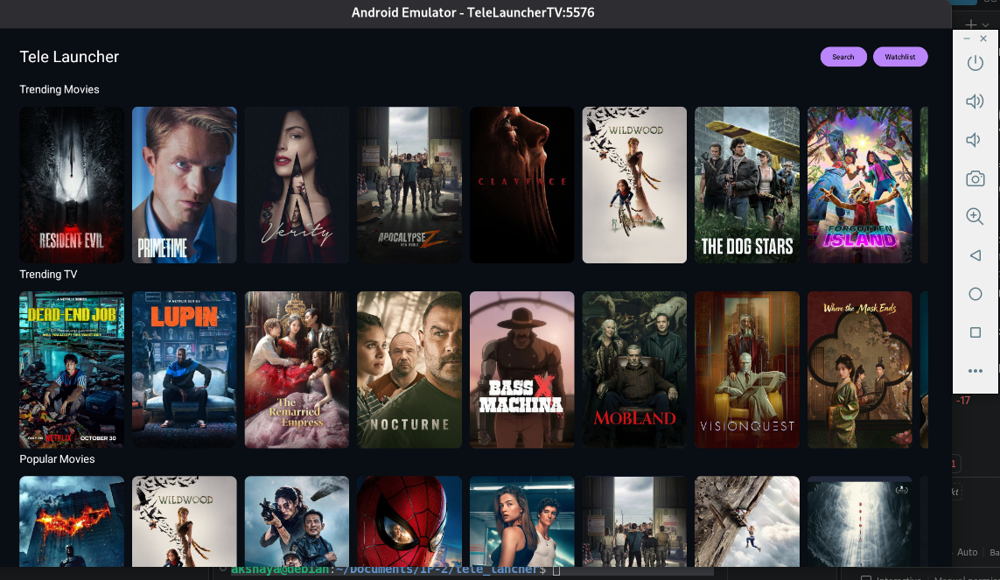
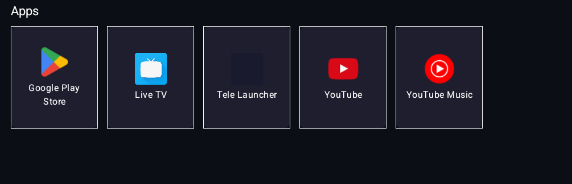
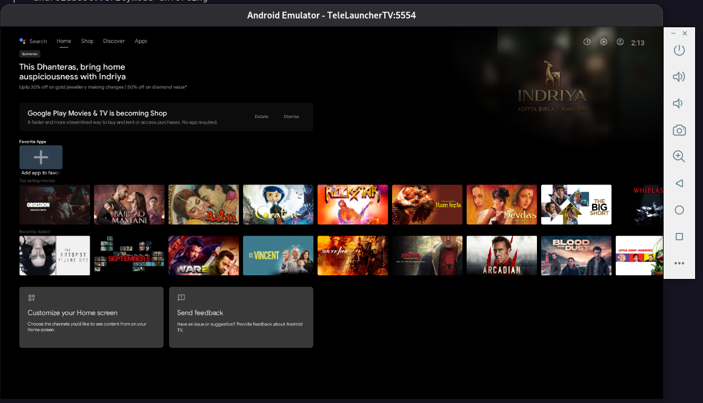
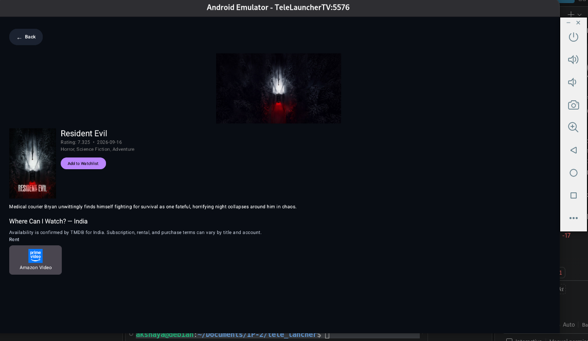
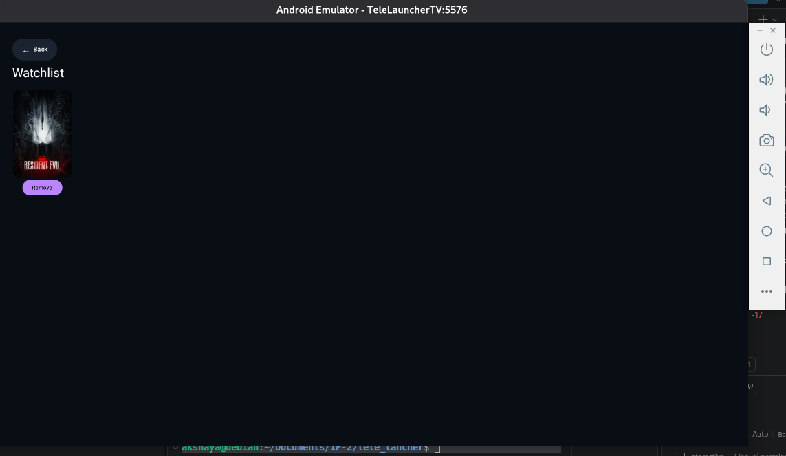

# Tele Launcher

A clean, customizable, advertisement-free Android TV launcher built for a better television experience.

## Project Goal

Tele Launcher provides a simple, modern, and distraction-free Android TV home screen that allows users to access their favorite applications easily without unnecessary advertisements or clutter.

Inspired by [Free My TV](https://github.com/simbasjungles/free-my-tv), this project explores building an alternative TV launcher with a remote-friendly interface, customizable application access, and a user-focused experience.

## Features Implemented

- **Cinematic Dark Dashboard** — Dark navy/black entertainment home screen with TV-friendly typography and spacing
- **Trending Movies & TV Shows** — Real TMDB API integration displaying trending content with posters, ratings, and details
- **Application Discovery** — Scans installed launchable applications via PackageManager
- **App Shelf** — Grid of installed app icons and names with one-tap launching
- **Movie/TV Details** — Backdrop, poster, title, rating, genres, release date, and overview
- **Watchlist** — Persistent local storage (SharedPreferences) for saving movies and TV shows; add/remove support
- **Search** — Search movies and TV shows via TMDB multi-search
- **D-Pad Navigation** — Remote-friendly focus navigation with visible focus borders and scaling
- **Enter/OK Activation** — Select focused items with the remote center button
- **Back Navigation** — Consistent back behavior across all screens
- **Android TV Launcher Integration** — Registers as a LEANBACK_LAUNCHER with HOME and DEFAULT intent filters
- **Loading, Empty, and Error States** — Clear feedback for all content states
- **TMDB API Key Configuration** — Secure local configuration via `local.properties` (never committed)

## Demo & Screenshots

### Demo Video

A short demo of Tele Launcher in action:

[Tele Launcher Demo](docs/demo/Tele_lancher_demo.mp4)

### Screenshots

#### Launcher Home


#### Home Screen Variations




#### Movie Details


#### Watchlist


## Technology Stack

- **Language:** Kotlin
- **UI Framework:** Jetpack Compose (Material 3)
- **Platform:** Android / Android TV (minSdk 24, targetSdk 34)
- **API:** TMDB API v3 (Retrofit + Gson)
- **Networking:** OkHttp
- **Image Loading:** Coil
- **Async:** Kotlin Coroutines
- **Persistence:** SharedPreferences (watchlist)
- **Build:** Gradle (Kotlin DSL)

## Prerequisites

- Android Studio (latest stable)
- Android SDK 34 (compileSdk)
- Android SDK Build-Tools 34.x
- Android SDK Platform-Tools
- A TMDB API v3 key (free): https://www.themoviedb.org/settings/api

## Setup

### 1. Clone the repository

```bash
git clone https://code.swecha.org/Akshaya_Kothakapu/tele_lancher.git
cd tele_lancher
```

### 2. Configure the TMDB API key

Create a `local.properties` file in the project root (this file is gitignored and never committed):

```properties
sdk.dir=/path/to/your/android/sdk
tmdb.api.key=YOUR_TMDB_API_KEY_V3
```

Replace `YOUR_TMDB_API_KEY_V3` with your actual TMDB API v3 key.

### 3. Build

```bash
./gradlew assembleDebug
```

The debug APK is generated at:
```
app/build/outputs/apk/debug/app-debug.apk
```

## Running on Android TV Emulator

1. Create an Android TV AVD (API 34, Android TV system image) in Android Studio
2. Start the emulator
3. Install the APK:

```bash
adb install -r app/build/outputs/apk/debug/app-debug.apk
```

4. Launch Tele Launcher:

```bash
adb shell monkey -p com.telelauncher 1
```

Or select Tele Launcher as the default Home launcher on the TV emulator.

## Running Tests

```bash
# Unit tests
./gradlew test

# Instrumentation tests (requires connected emulator/device)
./gradlew connectedAndroidTest
```

## Project Structure

```
tele_lancher/
├── build.gradle.kts              # Root Gradle build config
├── settings.gradle.kts           # Project settings
├── gradle.properties             # Gradle properties
├── gradlew / gradlew.bat         # Gradle wrapper
├── gradle/wrapper/               # Gradle wrapper files
├── app/
│   ├── build.gradle.kts          # App module build config
│   ├── src/main/
│   │   ├── AndroidManifest.xml   # App manifest (TV launcher filters, permissions)
│   │   ├── res/
│   │   │   ├── drawable/banner.xml
│   │   │   └── values/
│   │   │       ├── strings.xml
│   │   │       └── themes.xml
│   │   └── java/com/telelauncher/
│   │       ├── MainActivity.kt   # Entry point + theme
│   │       ├── ui/
│   │       │   ├── HomeScreen.kt # Dashboard, search, details, watchlist, app shelf
│   │       │   └── Theme.kt      # Dark entertainment theme
│   │       └── data/
│   │           ├── TmdbApi.kt            # TMDB Retrofit interface
│   │           ├── TmdbClient.kt         # TMDB Retrofit client
│   │           ├── TmdbRepository.kt     # TMDB data repository
│   │           ├── TmdbModels.kt         # Trending models
│   │           └── TmdbDetailModels.kt   # Detail/search models
│   └── src/androidTest/
│       └── java/com/telelauncher/
│           └── NavigationTest.kt   # Instrumentation test
├── .gitignore                    # Git ignore (excludes local.properties, build outputs, APKs)
├── local.properties.example      # Example local.properties (copy to local.properties)
└── README.md
```

## TMDB API Key Configuration

The app requires a TMDB API v3 key to load trending movies and TV shows.

1. Sign up at https://www.themoviedb.org/signup
2. Request an API key at https://www.themoviedb.org/settings/api (choose "Developer" / v3)
3. Add `tmdb.api.key=YOUR_KEY` to `local.properties`
4. The key is loaded at build time into `BuildConfig.TMDB_API_KEY` and is never committed to version control

Without a valid key, the dashboard shows: *"TMDB API key not configured. Add tmdb.api.key to local.properties."*

## Troubleshooting

**Build fails with "SDK location not found"**
- Set `sdk.dir` in `local.properties` or set the `ANDROID_HOME` environment variable

**Dashboard shows "Error: HTTP 401"**
- Your TMDB API key is missing or invalid. Verify `tmdb.api.key` is set in `local.properties` and the key is valid

**Dashboard shows "TMDB API key not configured"**
- Create `local.properties` with `tmdb.api.key=YOUR_KEY`

**No connected devices for tests**
- Start an Android TV or phone emulator, or connect a physical device, then run `./gradlew connectedAndroidTest`

**App not visible as Home launcher option**
- Verify the emulator is an Android TV (leanback) device. Tele Launcher registers `LEANBACK_LAUNCHER`, `HOME`, and `DEFAULT` categories

## License

This project is open source and available under the MIT License.

## Reference

- [Free My TV – GitHub Repository](https://github.com/simbasjungles/free-my-tv)
## Programmatic Video Tutorial

Run:
```bash
python3 video/render_tutorial.py
```
Requires: python3, Pillow, ffmpeg.
Output: video/tele_lancher_tutorial.mp4

## Social Media

- LinkedIn: https://lnkd.in/p/diXK3TVV
